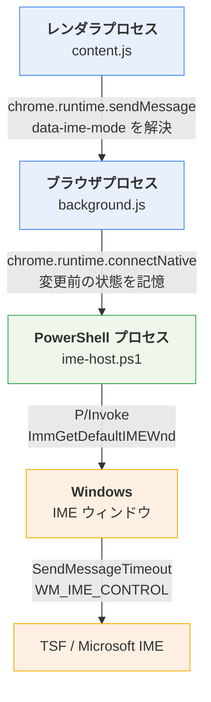
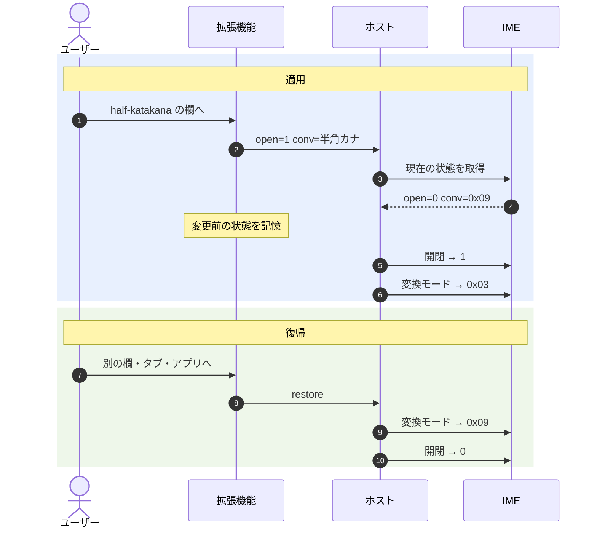
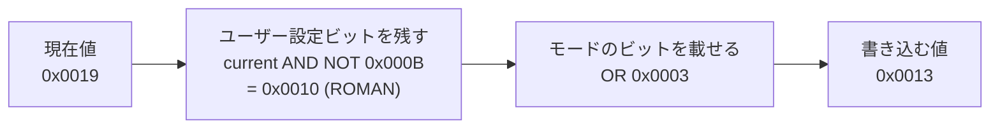

# data-ime-mode

日本語 | [简体中文](README.zh-CN.md)

IE の CSS `ime-mode` 相当を、Windows の Edge / Chrome で `data-ime-mode` 属性として再現するブラウザ拡張です。

作った経緯と、`inputmode` や IMM32 では代替できない理由は Zenn の記事「[IE の ime-mode を Edge の拡張機能で再現した](https://zenn.dev/fukunagajiro/articles/data-ime-mode)」に書いています。

```html
<input type="text" data-ime-mode="half-katakana">
```


| 値 | フォーカス時の挙動 | Access IMEMode |
|---|---|---|
| `inactive` | IME オフ | 2 |
| `active` | IME オン（変換モードは変えない） | 1 |
| `hiragana` | IME オン＋ひらがな | 4 |
| `katakana` / `full-katakana` | IME オン＋全角カタカナ | 5 |
| `half-katakana` | IME オン＋半角カタカナ | 6 |
| `full-alphanumeric` | IME オン＋全角英数字 | 7 |
| `half-alphanumeric` | IME オン＋半角英数字 | 8 |

日本語 IME が Windows にインストールされている場合、IME をオンにする欄へのフォーカスで入力言語を確認します。中国語や英語などが選択されていれば日本語 IME への切り替えを要求し、切り替えを確認してから欄のモードを適用します。日本語 IME が既に選択されていれば、現在の表示が `A` でも IME をオンにしてから変換モードを設定します。`inactive` は入力言語を切り替えません。

拡張が切り替えた入力言語は欄を離れる際に復帰を試みます。ユーザーが後から別の入力言語を選択した場合は、その選択を保持します。切り替えが拒否された場合はサービスワーカーのコンソールに理由を記録します。

その他の値・属性なしの要素は無視します。フォーカスが外れると
通常は開閉状態と変換モードを元に戻します。

いずれも「フォーカス時に状態を設定する」だけで、以降ユーザーは自由に
切り替えられます（IE の `ime-mode: inactive` / `active` と同じ考え方）。
IE の `ime-mode: disabled` のように切り替えを禁止することはできません。

### 入力モードを保持する

Access の `IMEHold = Yes` に対応する欄では、入力要素に `data-ime-hold="true"` を追加します。

```html
<input type="text" data-ime-mode="hiragana" data-ime-hold="true">
```

欄を離れる際に実際の IME の開閉・変換状態を記憶し、同じ入力要素に戻ったときに再適用します。同一文書内でモード指定のない欄へ移ると現在の状態を維持し、タブやウィンドウを離れると介入前の状態へ戻します。記憶は拡張のセッション中かつ同じ DOM 要素に対して有効です。ページの再読み込みや Vue が入力要素を作り直した場合は初期モードから始まります。

Vue の入力コンポーネントでは両方の属性が実際にフォーカスされる `input` または `textarea` に届くことを確認してください。Access での保持動作は [Microsoft の IMEHold 仕様](https://learn.microsoft.com/en-us/office/vba/api/access.textbox.imehold) を参照してください。

## この拡張機能がしないこと

`<all_urls>` のコンテンツスクリプトとネイティブメッセージング、その先の
PowerShell という構成は、見た目だけでは何をしていても不思議ではありません。
やっていないことを先に書きます。

- **入力値を読みません。** content.js が要素から読むのは `data-ime-mode` と
  `data-ime-hold` の属性です。`value` にも `input` イベントにも触れません。
- **通信しません。** ネットワークへ出る処理がありません。`host_permissions`
  も持たず、権限は `nativeMessaging` の 1 つだけです。
- **テレメトリも保存もありません。** `chrome.storage` を使わず、状態は
  現在の適用状態と保持対象の入力モードをメモリに持ちます。
- **IME の設定を書き換えません。** ホストが触るのは開閉状態と変換モードの
  3 ビット（`NATIVE` / `KATAKANA` / `FULLSHAPE`）だけで、ローマ字入力か
  かな入力かなどユーザー自身の設定はそのまま残します（[しくみ](#しくみ)）。
- **他アプリの IME に手を出しません。** 操作対象は対象ブラウザの
  ウィンドウで、適用前に前面ウィンドウとプロセスを照合します。
- **元に戻します。** 通常の欄を離れたり、ブラウザウィンドウから離れたりすると、フォーカス前の状態を復帰します。
  拡張機能が落ちてポートが切れた場合もホスト側が終了時に同じ復帰を行います。

ビルド工程や依存パッケージなしで、ソースのまま読み込めます。

## しくみ

### 構成

4 つのプロセス境界をまたいで属性が IME に届きます。



IMM32 の入力コンテキストはプロセスをまたげませんが、IME ウィンドウへの
`WM_IME_CONTROL` は単なるウィンドウメッセージなので別のプロセスのウィンドウにも届き、
CUAS 経由で TSF の開閉状態にも反映されます。**これがこの構成が成立する理由**です。

### フォーカスから復帰までの流れ

変換モードの変更は IME が開いている間しか反映されません。そのため
**適用時は「開閉 → 変換モード」、復帰時は「変換モード → 開閉」の逆順**で
書き込みます。



復帰先の hwnd は**記録しておいたもの**を使います。その時点のフォアグラウンド
ウィンドウを使うと、ユーザーが移動した先のアプリの IME を書き換えてしまうためです。
ポートが切れた場合はホスト側の `finally` が同じ復帰を行います。

変換モードのビット：

| 定数 | 値 |
|---|---|
| `IME_CMODE_NATIVE` | `0x0001` |
| `IME_CMODE_KATAKANA` | `0x0002` |
| `IME_CMODE_FULLSHAPE` | `0x0008` |

- ひらがな = `NATIVE | FULLSHAPE` = `0x09`
- 全角カタカナ = `NATIVE | KATAKANA | FULLSHAPE` = `0x0B`
- 半角カタカナ = `NATIVE | KATAKANA` = `0x03`

ホストは**この 3 ビットだけを書き換えます**。`IME_CMODE_ROMAN`
（ローマ字入力 / かな入力の別）などユーザー自身の設定は保存されます。



### フォーカスの引き継ぎと適用結果

同一フレーム内では、隣接欄への移動で復帰を挟まないよう `focusout` を 40 ms 待ちます。拡張のバックグラウンドはタブ・フレーム・文書で適用元を区別し、別のフレームに引き継いだ後に届く古い復帰要求を無視します。ウィンドウを切り替えるときは前のウィンドウの状態を復帰してから、新しいウィンドウへ適用します。

ホストは開閉や変換モードの書き込み結果を読み戻し、一致した場合に成功を返します。拡張はその結果を待ち、失敗理由をサービスワーカーのコンソールに記録します。送信や適用が失敗すると、次のフォーカスで同じモードを再試行できます。

### 事前起動（prewarm）

ホストの PowerShell プロセスは起動に時間がかかります。同一環境で 3 回ずつ測った値:

| 区間 | 時間 |
|---|---|
| ホスト起動 → 最初の応答（コールド） | 1,220 – 1,310 ms |
| 2 回目以降（ポート確立後） | 0.3 – 2.0 ms |
| 内訳: `powershell.exe` の起動だけ | 637 – 762 ms |
| 内訳: `Add-Type`（C# の実行時コンパイル）だけ | 340 – 468 ms |

フォーカスしてからこの時間がかかると、初回だけ IME の切り替わりが目に見えて遅れます。
そこで content.js は、**属性を持つ要素がある文書を開いた時点で** `ping` を 1 通
送ってホストを起動させておきます。判定は属性の存在だけで、値が既知のモードかは
見ません（値は後から変わりうるうえ、`modeOf()` と判定を二重に持つと食い違います）。

`ping` を選ぶ理由は、ホストがこれを最初に処理して即返し、**ウィンドウ解決も IME
操作もしない**ことです。`lastChange` も設定されないので、prewarm だけしてポートが
切れても復帰処理は走りません。

ポートを持つのはサービスワーカーなので、**1 度起動すれば全タブ・全フレームで共有
されます**。ページ遷移ごとに prewarm は走りますが、プロセスが起動するのは最初の
1 回だけで、2 回目以降は `ping` の往復（~1ms）で終わります。サービスワーカーが
破棄されてポートが切れた場合も、次のページ遷移が起動し直します。

なお、prewarm は `spec` を持たないメッセージです。background.js は**`spec` の判定より
前に**これを分岐させます。後ろに置くと、`msg.spec ? acquire(msg.spec) : release()` の
`release()` 側に落ちて、ページを開くたびに解放が走ります。

読み込み時点で対象欄が無く、あとから JavaScript で追加される文書だけは prewarm の
対象外です。その場合でも、同じセッションで属性を含むページを 1 度開いていれば
ホストは既に起動しています。

#### ブラウザの起動時

上の prewarm では塞げない場面があります。対象欄が `autofocus` されているページでは、
**属性が見えるようになる瞬間とフォーカスが起きる瞬間が同じ**なので、prewarm の
利得がゼロになります。ログインフォームはこの拡張機能の本命の用途で、しかも
`autofocus` を持つことが多いところです。

そのとき起きるのは単なる遅れではありません。1.2 秒のあいだまちがったモードで
打つことになり、**打鍵の途中で IME が切り替わります**。`data-ime-mode="inactive"`
を指定した ID 欄なら、その 1.2 秒は日本語入力のままです。

そこで `background.js` は `chrome.runtime.onStartup`、つまり **ブラウザの起動時**にも
`ping` を 1 通送ります。ページより前に温まるので、起動直後に開くページなら初回
フォーカスが間に合います。ただし `onStartup` が発火しない経路もあります。後述の
スタートアップ ブーストが有効な場合、拡張機能をセッションの途中で再読み込みした
場合、それにサービスワーカーが破棄されてポートが切れた場合です。最後のものは、
次のページ遷移でページ側の prewarm が起動し直します。

代償として、対象の欄を 1 度も触らない日でも、ブラウザを開いている間ずっとホストが
常駐します。実測でコミット 58.1 MB（起動直後の WorkingSet は 83.8 MB ですが、
アイドルのプロセスは Windows に切り詰められます）。CPU は 20 秒ごとの keepalive
込みでほぼゼロです。

なお Edge の「スタートアップ ブースト」やバックグラウンドでの実行が有効な場合、
ウィンドウを閉じてもブラウザ本体は終了しないため、次にウィンドウを開いても
起動時の事前起動は走りません。その状態ではポートもホストも生き続けているので、
起動し直す必要がないからです。この設定では、起動時の事前起動が効くのは再起動や
ログオンのあとの 1 回目になります。

## インストール

1. Edge は `edge://extensions`、Chrome は `chrome://extensions` を開き「開発者モード」を ON
2. 「展開して読み込み」で本リポジトリの `extension\` を選択
3. PowerShell で登録：

```powershell
powershell -ExecutionPolicy Bypass -File host\install.ps1
```

4. 使用するブラウザを**完全に終了**して起動し直す
5. ツールバー右上の**パズルピース型の「拡張機能」ボタン**から data-ime-mode を選び、
   「**✓ ネイティブホストに接続できています**」を確認
6. 拡張の詳細でファイル URL へのアクセスを許可し、`test\test.html` を開いて動作確認

拡張機能 ID は `extension\manifest.json` の `key`（公開鍵）から決まるので、
**フォルダをどこに置いても変わりません**。`install.ps1` はその ID を既定値に
持っているため、引数は要りません。ホストは現在の Windows ユーザーの Edge / Chrome 両方に登録されます。`key` を取り除いた版を読み込んだ場合だけ
`-ExtensionId <32文字のID>` で上書きしてください。異なる ID で配布する場合は PowerShell で `-ExtensionId @("Edge の ID", "Chrome の ID")` と指定できます。

ただし**フォルダを移動・コピーしたら `install.ps1` の再実行が必要**です。ID は
変わりませんが、ホストのマニフェストに書き込まれる `ime-host.bat` の絶対パスが
変わるためです。旧フォルダの登録がレジストリに残ったままだと、ブラウザは旧フォルダの
ホストを起動し続けます。コードを直したのに反映されない、という形で現れます。
`install.ps1` は付け替えが起きたときに旧パスを表示するので、そこで気付けます。

### 動かないとき

拡張機能のアイコン（青地に「あ」）をクリックすると、ホストへ実際に `ping` を通した
結果が出ます。未登録・往復できないはどちらも「欄にフォーカスしても何も起きない」と
いう同じ見え方になるので、まずここで切り分けてください。

展開して読み込んだ拡張機能はツールバーに自動では並びません。**パズルピース型の
「拡張機能」ボタン**を押すと一覧に出ます。行の右にあるピンを押せば常時表示に
できます。ポップアップにはホスト名と拡張機能 ID も出るので、レジストリの登録と
突き合わせられます。

| 表示 | 意味 | 対処 |
|---|---|---|
| ✓ 接続できています | ホストまで往復できている | 欄の挙動を `test\test.html` で確認 |
| ネイティブホストが登録されていません | レジストリに登録がない | PowerShell で data-ime-mode フォルダを開き、上記のインストールコマンドを実行して、使用中のブラウザを完全に終了してから起動し直す |
| 登録されているが往復できない | 旧フォルダを指したままか、ホストが起動できず即終了している | フォルダを移動したなら `install.ps1` を再実行。そうでなければ Constrained Language Mode / EDR が `Add-Type` を止めていないか確認（[既知の制約](#既知の制約)）。`host\debug.on` を置くとログが残る |

#### 拡張機能の一覧にカードが見当たらない

**開発者モードが OFF になっていないか**を見てください。OFF にするとブラウザは展開して
読み込んだ拡張機能を降ろします。このとき設定には「有効」という記録だけが残るので、
ON に戻しても復活しません。`extension\` を**もう一度「展開して読み込み」して
ください**。ID は `key` で固定されているので、読み込み直しても `install.ps1` の
再実行は要りません。

#### 動作の確かめ方

**欄にフォーカスしたまま、実際に打ってください。** `half-katakana` の欄で `aiueo` と
打って `ｱｲｳｴｵ` になれば動いています。

タスクバーの IME 表示を見に行くつもりで別のウィンドウへ切り替えると、その時点で
フォーカスがブラウザから離れ、**設計どおり元の状態へ復帰します**。「モードが切り替わら
ない」と見えるものの多くはこれで、拡張機能自体は正しく動いています。適用と復帰が
起きているかは `host\debug.on` を置けば分かります。対で記録されます。

### アンインストール

```powershell
powershell -ExecutionPolicy Bypass -File host\uninstall.ps1
```

## 既知の制約

- 入力欄のフォーカスに合わせてブラウザウィンドウの IME を切り替えます。`disabled`（Access の IMEMode 3）のロックは提供していません。
- IME の表示や変換動作は IME の種類・設定によって異なります。特に英数字は表示だけで判定せず、文字を入力して確認してください。
- ホストプロセスは **各ブラウザの起動時**に立ち、以降はポートが繋がったままなので
  セッション中 1 回だけです（[事前起動](#事前起動prewarm)）。**この拡張機能を
  入れている間は、対象の欄を使わない日でもホストが常駐します。**
- 企業の管理端末で AppLocker / WDAC による Constrained Language Mode が
  有効な場合、`Add-Type` の P/Invoke がブロックされて動作しません。
  EDR がブラウザからの PowerShell 起動を遮断する構成でも同様です。

## テスト

| 実行するもの | 確認内容 |
|---|---|
| `node test\content.test.js` | content.js の状態遷移。上の状態遷移図の各辺と、送信失敗からの復帰 |
| `powershell -File test\host.test.ps1` | ホストの変換モード計算。適用時のマスクと復帰時の書き戻し |
| `powershell -File test\host.e2e.ps1` | ホストを実際に起動し、`WM_IME_CONTROL` の往復まで通した動作。適用・復帰・ポート断の保険 |
| `test\test.html` | 拡張機能を入れた状態での実際の IME 表示 |
| `test-ime-toggle.ps1` | 拡張機能を介さず、IME のオン/オフ切り替えが自環境で効くか |
| `test-ime-conversion.ps1` | 同上、ひらがな / 全角カタカナ / 半角カタカナの切り替え |

上 2 つは依存パッケージも Edge も不要で、**IME には一切触りません**。
`content.test.js` は最小限の DOM と `chrome.runtime` のスタブ上で content.js を
読み込みます。`host.test.ps1` は `ime-host.ps1` から関数定義を AST で取り出し、
Win32 呼び出しをスタブに差し替えて計算だけを確認します。

`host.e2e.ps1` はホストを Native Messaging プロトコルで起動し、background.js が
送るのと同じ JSON を流します。合否はホストの返答ではなく、スクリプト自身の Win32
読み取りで判定します。**IME を実際に操作しますが、対象は使い捨ての専用ウィンドウ
だけ**なので Edge と今の IME 状態には触りません。相手が WinForms のテキストボックス
であって Edge ではない点が、この確認の届く範囲です。`-Log` を付けるとホストの
診断ログも残ります。

ブラウザ側（`focusin` / 離脱 / 再適用）を実際の Edge / Chrome で動かす確認は `test\test.html` を開いて手で行います。両方を同時に開き、マウスと Tab、iframe 間の移動、他アプリへの切り替え、日本語変換中の移動も確認してください。

### 診断ログ

`host\debug.on` を置くと、ホストが読み書きした値を `host\debug.log` に記録します
（stdout はプロトコル専用なので必ずファイルへ出します）。要求 JSON、対象 hwnd、
IMC の往復と所要時間、計算した target、書き込み後の読み直しが
残ります。有効化にはホストの再起動＝拡張機能の再読み込みが必要です。
確認が終わったら `host\debug.on` を削除してください。

## ライセンス

MIT License（[LICENSE](LICENSE)）
