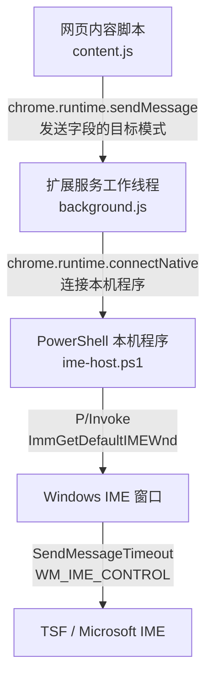
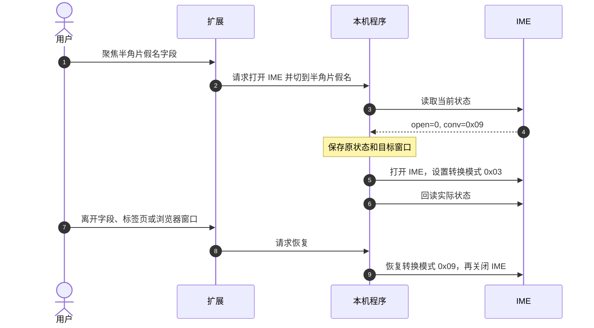

# data-ime-mode

[日本語](README.md) | 简体中文

这是一个适用于 Windows 上 Microsoft Edge 和 Google Chrome 的浏览器扩展。它通过 HTML 的 `data-ime-mode` 属性，在输入框获得焦点时设置 Windows 输入法（IME）的模式，实现类似 Internet Explorer 的 CSS `ime-mode` 的行为。项目背景以及 `inputmode` 和直接使用 IMM32 输入上下文的局限，见[作者的日文文章](https://zenn.dev/fukunagajiro/articles/data-ime-mode)。

```html
<input type="text" data-ime-mode="half-katakana">
```


| 属性值 | 获得焦点时的行为 | Access IMEMode |
|---|---|---|
| `inactive` | 关闭 IME | 2 |
| `active` | 打开 IME，沿用当前转换模式 | 1 |
| `hiragana` | 打开 IME，设为平假名 | 4 |
| `katakana` 或 `full-katakana` | 打开 IME，设为全角片假名 | 5 |
| `half-katakana` | 打开 IME，设为半角片假名 | 6 |
| `full-alphanumeric` | 打开 IME，设为全角英数字 | 7 |
| `half-alphanumeric` | 打开 IME，设为半角英数字 | 8 |

Windows 已安装日语 IME 时，聚焦需要打开 IME 的字段会先确认浏览器当前的输入语言。如果当前是中文或英文，扩展请求切到已安装的日语 IME，再设置字段模式。如果已经使用日语 IME，即使它当前显示 `A`，也会先打开 IME，再应用片假名等模式。`inactive` 只关闭当前 IME，不请求切换输入语言。

离开受控字段后，扩展尝试恢复它自动切换前的输入语言。如果用户后来自行选择了另一输入语言，会保留用户的选择。Windows 或浏览器拒绝请求时，服务工作线程会记录失败。

未设置属性或属性值未知时，扩展不会主动设置新模式。一般情况下，离开受控字段后会恢复聚焦前的 IME 开关和转换模式。聚焦后，用户仍可手动切换输入法。

### 保留输入模式

对于 Access 中设置了 `IMEHold = Yes` 的字段，在输入元素上加上 `data-ime-hold="true"`。

```html
<input type="text" data-ime-mode="hiragana" data-ime-hold="true">
```

扩展在离开字段时记住实际的 IME 开关和转换模式，回到同一个输入元素时重新应用。移到同一文档内未指定模式的字段时，保持当前状态。离开浏览器标签页或窗口时，恢复扩展介入前的状态。记忆保存在扩展会话内，并与当前 DOM 元素关联。刷新页面或 Vue 重新创建该输入元素后，会从初始模式开始。

使用 Vue 输入组件时，确认两个属性都传到了实际获得焦点的 `input` 或 `textarea` 元素。 [Microsoft Access 的 IMEHold 说明](https://learn.microsoft.com/en-us/office/vba/api/access.textbox.imehold)

## 扩展权限与数据处理

扩展通过 `<all_urls>` 在网页加载内容脚本，并用 `nativeMessaging` 连接本机 PowerShell 程序。可以直接加载源码，无需构建或安装依赖包。

- 内容脚本只读取元素的 `data-ime-mode` 和 `data-ime-hold` 属性，不读取输入值，也不监听 `input` 事件。
- 扩展不发起网络请求，不声明 `host_permissions`，也不收集遥测数据。应用中的模式和需要保留的字段状态都存放在内存中，不使用 `chrome.storage`。
- 应用模式时，本机程序只修改 IME 的开关和转换模式中的三个标志位，保留罗马字输入、假名输入等用户设置。
- 应用模式前会核对前台窗口和进程。恢复时会使用之前记录的窗口。扩展连接断开时，本机程序在退出前尝试恢复原状态。

## 工作原理

### 组件与通信



IMM32 的输入上下文不能直接跨进程使用。扩展让本机程序获取目标窗口的 IME 窗口，再发送 `WM_IME_CONTROL` 窗口消息。这条路径可以跨进程传递，并可通过 CUAS 反映到 TSF 的 IME 开关状态。

### 从聚焦到恢复

转换模式的修改仅在 IME 打开时生效。应用模式时先打开 IME，再设置转换模式。恢复时先恢复转换模式，再恢复原有开关状态。



恢复时使用保存的窗口句柄（`hwnd`），避免把原状态写到用户刚切过去的应用。连接断开时，本机程序也会在 `finally` 中执行恢复。

| 转换标志 | 值 |
|---|---|
| `IME_CMODE_NATIVE` | `0x0001` |
| `IME_CMODE_KATAKANA` | `0x0002` |
| `IME_CMODE_FULLSHAPE` | `0x0008` |

- 平假名设置 `NATIVE | FULLSHAPE`，即 `0x09`。
- 全角片假名设置 `NATIVE | KATAKANA | FULLSHAPE`，即 `0x0B`。
- 半角片假名设置 `NATIVE | KATAKANA`，即 `0x03`。

例如，当前转换值为 `0x0019` 时，清除模式掩码 `0x000B` 得到 `0x0010`。这个值保留了 `IME_CMODE_ROMAN`。再合并半角片假名的 `0x0003`，最终写入 `0x0013`。

### 焦点交接与结果确认

同一 iframe 内的字段失焦时，扩展等待 40 毫秒，避免相邻受控字段之间切换时先恢复再设置。后台按标签页、iframe 和文档识别请求来源。新 iframe 接管后，旧 iframe 晚到的恢复请求会被忽略。切换浏览器窗口时，扩展先恢复前一个窗口，再向新窗口应用模式。

本机程序写入后回读 IME 的开关和转换模式，实际结果与请求一致才返回成功。扩展会等待结果，在服务工作线程的控制台记录失败原因。发送或应用失败后，下次聚焦时可以重试同一模式。

### 本机程序预启动

原作者在同一环境下各测了三次，结果如下。

| 阶段 | 耗时 |
|---|---|
| 冷启动到首次响应 | 1,220–1,310 毫秒 |
| 连接建立后的响应 | 0.3–2.0 毫秒 |
| 其中，启动 `powershell.exe` | 637–762 毫秒 |
| 其中，`Add-Type` 在运行时编译 C# | 340–468 毫秒 |

为减少首次聚焦时的等待，内容脚本在文档加载完成时检查是否存在 `data-ime-mode` 属性。有此属性就发送一条 `ping`，无需先判断模式是否有效。该请求只建立并验证连接，不查找窗口、修改 IME 或记录待恢复的状态。

连接由扩展的服务工作线程持有，同一浏览器会话的标签页和 iframe 共用它。新页面发送的后续 `ping` 通常只需一次短往返。如果连接随服务工作线程被回收，下一个带属性的页面可以重新启动本机程序。只在页面加载后才动态添加字段的页面，不会触发页面加载时的预启动。后台会先处理预启动请求，再处理字段模式请求，以免将缺少 `spec` 的 `ping` 当作恢复请求。

服务工作线程也会在浏览器的 `onStartup` 事件中发送 `ping`。这是为了让登录表单等带 `autofocus` 的页面更早准备好本机程序，降低用户打字时输入模式才发生切换的可能性。重新加载扩展或服务工作线程被回收时，浏览器启动事件不一定重新触发。Edge 的启动增强和后台运行也可能让浏览器进程在窗口关闭后继续存活，此时已有的连接可继续使用。

启用扩展后，每个浏览器会话通常都会有一个本机程序常驻。原作者测得提交内存约 58.1 MB，启动时工作集约 83.8 MB。连接每 20 秒保活一次，空闲时 CPU 占用接近零。

## 安装

1. 在 Windows 上打开 `edge://extensions` 或 `chrome://extensions`，启用**开发人员模式**。
2. 点击**加载解压缩的扩展程序**，选择仓库中包含 `manifest.json` 的 `extension` 文件夹。两个浏览器都要测试时，分别加载一次。
3. 用 PowerShell 打开 `data-ime-mode` 仓库根目录，执行下面的命令。脚本会为当前 Windows 用户同时注册 Edge 和 Chrome 的本机程序。

   ```powershell
   powershell.exe -NoProfile -ExecutionPolicy Bypass -File .\host\install.ps1
   ```

4. 完全退出正在测试的浏览器，包括仍在后台运行的实例，然后重新打开。
5. 从浏览器工具栏的拼图图标打开 **data-ime-mode**，确认显示 **✓ ネイティブホストに接続できています**，即本机程序已连接。
6. 在扩展详情中启用**允许访问文件网址**，然后在浏览器里打开[测试页](test/test.html)。

新安装使用本机程序名称 `data_ime_mode`。如果只注册了旧名称，扩展会自动连接旧注册。要迁移到新名称，重新运行安装命令并重启浏览器即可。扩展弹窗会显示实际连接的名称。

扩展 ID 由 [manifest.json](extension/manifest.json) 中的 `key` 公钥决定，与目录位置无关。安装脚本默认使用这个 ID。如果移除了公钥，需要通过 `-ExtensionId` 传入实际的 32 字符扩展 ID。分别发布、产生不同 ID 时，可从 PowerShell 用 `-ExtensionId @("Edge 的 ID", "Chrome 的 ID")` 传入两个 ID。

移动或复制仓库后，要在新目录重新运行安装脚本，因为本机程序清单保存的是 `ime-host.bat` 的绝对路径。覆盖已有注册时，安装脚本会显示旧路径，便于核对。

### 故障排查

点击扩展图标会实际发送一条 `ping`。弹窗会同时显示本机程序名称和扩展 ID，可以用来检查注册信息。扩展未固定到工具栏时，可从拼图菜单打开或固定它。

| 弹窗显示 | 含义与处理 |
|---|---|
| **✓ ネイティブホストに接続できています** | 已连通本机程序。到[测试页](test/test.html)实际打字，确认 IME 模式。 |
| **ネイティブホストが登録されていません。** | 本机程序未注册。在仓库根目录执行[安装命令](#安装)，然后完全退出并重开当前浏览器。 |
| **ホストは登録されていますが往復できません** | 已注册，但本机程序未响应。若移动过仓库，先重新安装。否则检查终端策略是否拦截 PowerShell 或 `Add-Type`，并查看[诊断日志](#诊断日志)。 |

如果扩展没有出现在扩展列表里，确认开发人员模式已开启，并重新加载 `extension` 文件夹。原公钥保持不变时，重新加载扩展不会改变 ID。

验证模式时请保持焦点在输入框中实际打字。例如，在 `half-katakana` 字段键入 `aiueo`，日语 IME 正常应用时应得到 `ｱｲｳｴｵ`。切到另一个窗口检查任务栏时，扩展可能已经恢复了原模式。

### 卸载

从 Edge 和 Chrome 中移除扩展，然后在仓库根目录运行以下命令，清除两个浏览器的本机程序注册。

```powershell
powershell.exe -NoProfile -ExecutionPolicy Bypass -File .\host\uninstall.ps1
```

## 已知限制

- 扩展能在聚焦时设置模式。Access 的 `IMEMode=3` 强制锁定输入法尚未实现。
- 不同 IME 或设置下，任务栏图标和转换行为可能不同。尤其是全角、半角英数字，请用实际输入的字符判断。
- 浏览器会话通常会保持本机程序运行，即使暂时没有打开受控字段。
- 如果单位设备的 AppLocker 或 WDAC 启用了 PowerShell 受限语言模式，`Add-Type` 中的 P/Invoke 可能被阻止。终端防护软件也可能阻止浏览器启动 PowerShell。

## 测试

| 命令或入口 | 验证内容 |
|---|---|
| `node .\test\content.test.js` | 使用模拟 DOM 和扩展 API，验证焦点切换、跨 iframe 交接和失败后的重试。 |
| `powershell.exe -NoProfile -ExecutionPolicy Bypass -File .\test\host.test.ps1` | 使用模拟 Win32 调用，验证转换模式位、状态恢复和写入后的结果确认。 |
| `powershell.exe -File .\test\host.e2e.ps1` | 启动本机程序和专用 WinForms 窗口，验证 Native Messaging、IME 设置、恢复和断线处理。 |
| [浏览器测试页](test/test.html) | 在安装了扩展的 Edge 和 Chrome 中进行实际输入测试。 |
| [test-ime-toggle.ps1](test-ime-toggle.ps1) | 单独检查当前 Windows 环境能否打开或关闭 IME。 |
| [test-ime-conversion.ps1](test-ime-conversion.ps1) | 单独检查平假名、全角和半角片假名能否切换。 |

前两项不依赖浏览器，也不会操作实际输入法。WinForms 测试通过实际回读 Win32 状态判断结果，可用 `-Log` 保留本机程序日志。它验证的是专用原生窗口，浏览器行为须用测试页验证。

在 Edge 和 Chrome 中分别打开测试页。先选中日语 IME 并保持 `A`，点击全角片假名字段并输入 `aiueo`，检查是否得到 `アイウエオ`。再从中文或英文输入法开始重复测试，检查离开字段后原输入语言是否恢复。验证鼠标、Tab 和 Shift+Tab 聚焦，再验证全角和半角英数字、`IMEHold`、跨 iframe 切换和转换过程中离开字段。两个浏览器同时打开时，也检查切到另一浏览器或其他应用是否会串用输入模式。

### 诊断日志

在仓库根目录创建 `host\debug.on`，重新加载扩展以重启本机程序，然后重新复现问题。请求 JSON、目标窗口句柄、读取和写入耗时以及回读结果会写入 `host\debug.log`。标准输出保留给 Native Messaging 协议。排查完后移除 `host\debug.on`，再重新加载扩展以关闭日志。

## 许可证

MIT 许可证。 [LICENSE](LICENSE)
